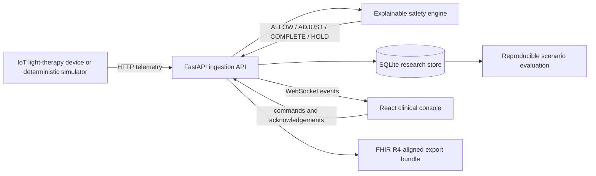

# LumaCare DSS architecture

LumaCare DSS is a research software prototype for explainable decision support during supervised light-therapy sessions. It separates device telemetry, safety inference, clinical workflow, persistence, and user interaction so that every recommendation can be reconstructed from stored inputs and fired rules.

## Safety boundary

The prototype never sends direct commands to a medical light source. It produces a recommendation, records the input values and rules, and exposes an operator-controlled session state. Any connection to real hardware requires device-specific verification, risk management, cybersecurity controls, and the regulatory evidence applicable to the intended use.

## Traceability

Each telemetry sample is linked to one therapy session. Each computed decision stores its state, parameter recommendation, confidence, reasons, and fired rule identifiers. Alerts and operator acknowledgements are recorded in the audit trail. This structure supports replay, failure analysis, and scenario-based evaluation.

